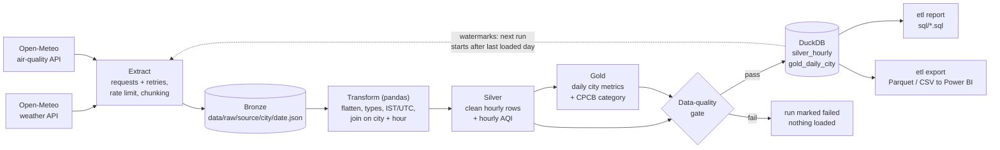

# india-air-quality-etl

An incremental ETL pipeline that pulls hourly **weather and air-quality data for eight major
Indian cities** from the free, keyless [Open-Meteo](https://open-meteo.com/) APIs, lands the
raw JSON as a bronze layer, cleans and joins it with pandas (silver), aggregates daily city
metrics with Indian CPCB AQI categories (gold), runs data-quality gates, and loads everything
into a **DuckDB** warehouse with idempotent upserts, per-city watermarks and a run-audit table.
A small CLI runs the pipeline, prints SQL analysis reports, and exports gold tables to
Parquet/CSV for Power BI.

**Stack:** Python 3.12+, Requests (urllib3 retries), pandas, DuckDB, Typer, pytest, ruff,
GitHub Actions. Optional PySpark example.

## How it works



| Layer  | Where                                   | Contents                                                  |
|--------|-----------------------------------------|-----------------------------------------------------------|
| Bronze | `data/raw/<source>/<city>/<date>.json`  | Raw API response, one file per source/city/day            |
| Silver | `silver_hourly` (DuckDB)                | One row per city per hour: weather + pollutants + AQI     |
| Gold   | `gold_daily_city` (DuckDB, exports)     | One row per city per day: aggregates + CPCB AQI category  |
| Ops    | `watermarks`, `pipeline_runs` (DuckDB)  | Last loaded date per city; audit trail of every run       |

## Quickstart

```bash
git clone https://github.com/RutuK2005/india-air-quality-etl.git
cd india-air-quality-etl
python -m venv .venv
source .venv/bin/activate          # Windows: .venv\Scripts\activate
pip install -e ".[dev]"

etl run --start 2026-11-08 --end 2026-11-10   # explicit range, all cities
etl run --incremental                         # only days after each city's watermark
etl backfill --days 30                        # reload the last 30 complete days (safe to repeat)
etl status                                    # watermarks, table sizes, recent runs
etl report                                    # run every query in sql/ and print tables
etl report --name rain                        # run only matching queries
etl export                                    # data/exports/*.parquet + gold CSV
```

Cities, API variables, chunk size, rate limit and the DQ null threshold live in
[`config.toml`](config.toml). Use `etl --config other.toml ...` to point at another file and
`etl -v ...` for debug logging.

## Sample output

Real output of `etl report` after loading **2026-11-08 to 2026-11-10 (IST), all 8 cities**
from the live API on 2026-11-11 (first three of six reports shown). The run loaded
1,152 bronze hourly records (weather + air quality) into 576 silver rows and 24 gold rows.

```text
City ranking by average PM2.5 (worst first)
     city  days  avg_pm2_5  peak_hourly_pm2_5  pct_poor_or_worse
    Delhi     3      112.1              201.2              100.0
  Kolkata     3       86.1              171.8               33.0
   Mumbai     3       54.8               97.3                0.0
  Chennai     3       45.8               64.0                0.0
Hyderabad     3       36.4               56.1                0.0
     Pune     3       32.4               44.8                0.0
Bengaluru     3       29.7               53.4                0.0
Ahmedabad     3       27.3               51.9                0.0

Worst AQI day per city
     city       date  aqi_pm25 aqi_category  avg_pm2_5  total_precip_mm
    Delhi 2026-11-10       312    Very Poor     136.03              0.0
  Kolkata 2026-11-08       252         Poor     105.71              0.0
   Mumbai 2026-11-09        95 Satisfactory      56.73              0.0
  Chennai 2026-11-09        91 Satisfactory      54.60              0.3
Hyderabad 2026-11-08        72 Satisfactory      43.31              0.0
Bengaluru 2026-11-10        69 Satisfactory      41.53              0.0
     Pune 2026-11-09        60 Satisfactory      35.90              0.0
Ahmedabad 2026-11-08        52 Satisfactory      31.42              0.0

Rain vs PM2.5 (hourly)
     city  rainy_hours  pm2_5_rainy  pm2_5_dry  corr_rain_pm2_5  corr_wind_pm2_5
Ahmedabad            0          NaN       27.3              NaN             0.14
Bengaluru            3         13.3       30.4            -0.33            -0.21
  Chennai            7         27.5       47.7            -0.28             0.56
    Delhi            0          NaN      112.1              NaN            -0.23
Hyderabad            0          NaN       36.4              NaN            -0.23
  Kolkata            8         95.0       85.0             0.02             0.09
   Mumbai            0          NaN       54.8              NaN            -0.29
     Pune            0          NaN       32.4              NaN            -0.49
```

Three days is far too short to draw conclusions (most cities had no rain at all, so their
correlation is empty); the output is shown to demonstrate the pipeline, not as findings.
Re-running the same range again (once as `run`, once as `backfill --days 2`) left the
tables at exactly 576 silver / 24 gold rows: the idempotency guarantee in action.

## Gold table: `gold_daily_city`

Primary key: `(city, date)`. Dates are local IST calendar days.

| Column             | Type      | Description                                                |
|--------------------|-----------|------------------------------------------------------------|
| `city`             | VARCHAR   | City name from `config.toml`                               |
| `date`             | DATE      | Calendar day in Asia/Kolkata                               |
| `avg_temp_c`       | DOUBLE    | Mean air temperature at 2 m (deg C)                        |
| `min_temp_c`       | DOUBLE    | Minimum hourly temperature (deg C)                         |
| `max_temp_c`       | DOUBLE    | Maximum hourly temperature (deg C)                         |
| `avg_humidity_pct` | DOUBLE    | Mean relative humidity (%)                                 |
| `total_precip_mm`  | DOUBLE    | Total precipitation (mm)                                   |
| `rainy_hours`      | INTEGER   | Hours with precipitation > 0.1 mm                          |
| `avg_wind_kmh`     | DOUBLE    | Mean wind speed at 10 m (km/h)                             |
| `avg_pm2_5`        | DOUBLE    | 24-hour mean PM2.5 (ug/m3)                                 |
| `max_pm2_5`        | DOUBLE    | Worst hourly PM2.5 (ug/m3)                                 |
| `avg_pm10`         | DOUBLE    | Mean PM10 (ug/m3)                                          |
| `avg_no2`          | DOUBLE    | Mean nitrogen dioxide (ug/m3)                              |
| `avg_o3`           | DOUBLE    | Mean ozone (ug/m3)                                         |
| `aqi_pm25`         | INTEGER   | CPCB PM2.5 sub-index (0-500) from the 24-hour mean         |
| `aqi_category`     | VARCHAR   | Good / Satisfactory / Moderate / Poor / Very Poor / Severe |
| `hours_observed`   | INTEGER   | Hours with a PM2.5 value (24 for a complete day)           |
| `run_id`           | VARCHAR   | Pipeline run that last wrote the row (lineage)             |
| `loaded_at`        | TIMESTAMP | When the row was last written                              |

`silver_hourly` has the same measures per hour (key `(city, ts_ist)`) plus `ts_utc`,
`date_ist`, `hour` and an indicative hourly `aqi_category`.

## Power BI

1. `etl export` writes `data/exports/gold_daily_city.parquet` and `.csv`
   (plus `silver_hourly.parquet` for hourly visuals).
2. In Power BI Desktop: **Get Data > Parquet** (or **Text/CSV**) and select the file.
3. Check that `date` is typed as Date, then build visuals, e.g. a line chart of
   `avg_pm2_5` by `date` with `city` as the legend, or a matrix of `aqi_category` counts.
4. After the next pipeline run, run `etl export` again and press **Refresh**.

## Design decisions and trade-offs

- **DuckDB as the warehouse.** An embedded, columnar SQL engine in a single file: no server
  to run, fast analytical queries, native pandas and Parquet support, and real primary keys
  and transactions. The trade-off is one writer at a time: fine for a batch job, not for
  many concurrent writers (that is where Postgres, BigQuery or Snowflake come in).
- **Idempotent loads.** Each table has a natural primary key (`city, ts_ist` / `city, date`).
  Rows are staged in a temp table and merged with `INSERT OR REPLACE`, so re-running any
  date range updates rows in place instead of duplicating them. Bronze files are keyed the
  same way and simply overwritten.
- **Watermarks for incremental runs.** `watermarks` stores the last successfully loaded date
  per city. `--incremental` fetches from the day after the watermark up to yesterday (the
  last complete day). Watermarks only move forward (`greatest()`), so a backfill of old dates
  never causes recent days to be fetched again, and they are updated in the **same
  transaction** as the data, so a crash can never advance a watermark past unloaded data.
- **Data-quality gate before load.** Hand-written checks (rather than pandera) keep every rule
  visible in one short module: schema, non-null keys, maximum null share for measures,
  physical ranges (e.g. humidity 0-100) and uniqueness of `(city, ts_ist)`. Any failure
  raises, nothing is written, and the error is stored in `pipeline_runs`.
- **Bronze kept as raw JSON.** Transform reads bronze, not the HTTP response, so silver and
  gold can be rebuilt (or the logic changed) without calling the API again.
- **Outer join of weather and air quality.** Keeps hours that one source is missing; the DQ
  null-share check then decides whether the gap is acceptable, instead of rows silently
  disappearing in an inner join.
- **Time zones.** Data is requested in `Asia/Kolkata`, so a "day" means an IST day. Timestamps
  are stored as naive IST and UTC side by side so results never depend on the DuckDB session
  time zone (India has no daylight saving, so the conversion is unambiguous).
- **AQI.** CPCB defines AQI on a 24-hour mean, so the gold category uses the daily mean; the
  hourly category in silver is only indicative. Only the PM2.5 sub-index is computed, not the
  full multi-pollutant AQI.
- **Archive vs forecast endpoint.** The ERA5 archive lags by about five days, so recent days
  come from the forecast API's model data. Those values can be revised later; because loads
  are idempotent, a `backfill` simply overwrites them.
- **Whole-run failure.** If any city still fails after retries, the run fails and nothing is
  loaded. Simple and consistent; a larger system might load the cities that succeeded.
  Incremental runs with nothing to do are skipped and not written to `pipeline_runs`.

**About the data:** Open-Meteo air quality is modelled grid data (CAMS), not CPCB ground
station measurements, so values will differ from official station AQI.

## Tests and linting

```bash
pytest          # 58 tests, no network: recorded API responses in tests/fixtures/
ruff check .
```

The tests cover AQI breakpoints, chunking and bronze landing, the HTTP retry configuration,
transform correctness (including IST/UTC conversion and the outer join), every DQ check, and
end-to-end runs against a temporary DuckDB file: idempotent re-loads, watermark planning,
monotonic watermarks on backfill, and the DQ failure path (nothing loaded, run audited as
failed). `scripts/record_fixtures.py` re-records the fixtures. CI runs ruff and pytest on
Python 3.12 and 3.13 (`.github/workflows/ci.yml`).

`.github/workflows/scheduled.yml` runs `etl run --incremental` daily (cron plus manual
trigger), restores the previous warehouse from the Actions cache so watermarks carry over,
and uploads the DuckDB file and exports as a workflow artifact. Data is never committed.

## Project layout

```text
config.toml              cities, API variables, pipeline settings
src/aq_etl/
  config.py              TOML -> typed Settings / City dataclasses
  extract.py             HTTP client (retries, rate limit), chunking, bronze landing
  transform.py           bronze -> silver (hourly) -> gold (daily) with pandas
  aqi.py                 CPCB PM2.5 categories and sub-index
  quality.py             data-quality checks and DataQualityError
  warehouse.py           DuckDB schema, upserts, watermarks, run audit
  pipeline.py            orchestration and incremental planning
  reports.py             run sql/ queries, export Parquet/CSV
  cli.py                 `etl` command (Typer)
sql/                     six analysis queries used by `etl report`
spark/                   optional PySpark version of the gold aggregation
scripts/                 fixture recorder
tests/                   pytest suite + recorded fixtures
docs/walkthrough.md      study guide: modules, concepts, interview Q&A
```

## Optional: Spark

[`spark/`](spark/README.md) contains a short PySpark job that builds the gold table from the
exported silver Parquet, to show how the pandas aggregation maps to Spark at larger scale.
It is not required by the pipeline or the tests.

## Next steps

- Re-pull the last few days on each incremental run to pick up revised model data.
- Add ground-station data (CPCB / OpenAQ) and compare it with the modelled values.
- Orchestrate with Airflow or Prefect, with alerts when the DQ gate fails.
- Move the SQL layer into dbt models with tests and documentation.
- Publish a Power BI dashboard on top of the exported gold table.

## Data credits and license

Weather and air-quality data from [Open-Meteo.com](https://open-meteo.com/), licensed under
[CC BY 4.0](https://creativecommons.org/licenses/by/4.0/). Air-quality data is based on the
Copernicus Atmosphere Monitoring Service (CAMS); historical weather on ERA5 reanalysis. This
project does not redistribute the data: it is fetched at run time and never committed.

Code is released under the [MIT License](LICENSE).
